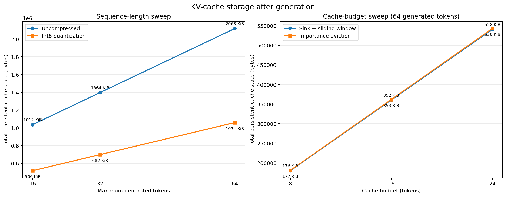
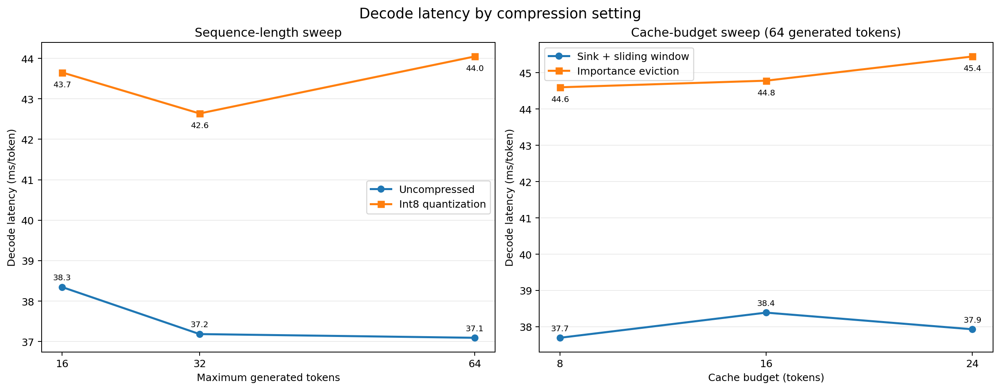
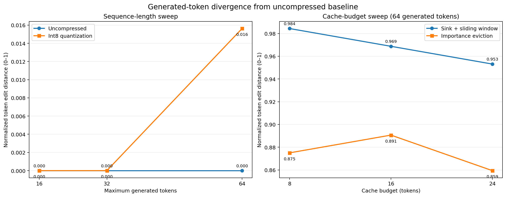

# KV Cache Compression for TinyLlama

During autoregressive decode the KV cache grows linearly with sequence length,
and decode is memory-bandwidth bound, so cache size drives both memory footprint
and latency. This project implements three KV cache compression methods inside a
layer-by-layer TinyLlama-1.1B inference loop and measures the memory / latency /
output-quality trade-off of each against an uncompressed baseline.

I implemented the three methods in `code/less_minimal_full_server.py`:
sink-aware sliding-window eviction, attention-importance eviction, and
symmetric int8 quantization. All methods run through the manual `--verbose`
inference path and are selected with
`--compression {none,window,importance,quant}`.

**Headline result:** int8 quantization halved persistent KV state with nearly
identical output (normalized token edit distance 0–0.016), while aggressive
eviction cut state by up to 91.5% but changed the generated text almost
entirely at these budgets.

## Quick start

```bash
python3 -m venv .venv && source .venv/bin/activate
pip install -r code/requirements.txt

# Uncompressed baseline
python code/less_minimal_full_server.py --verbose --max-tokens 64

# Compressed variants
python code/less_minimal_full_server.py --verbose --max-tokens 64 --compression window --cache-budget 16
python code/less_minimal_full_server.py --verbose --max-tokens 64 --compression importance --cache-budget 16
python code/less_minimal_full_server.py --verbose --max-tokens 64 --compression quant

# Regenerate results/summary.csv and plots/ from the logs in results/
python code/analyze_results.py
```

A CUDA GPU is recommended for timing; `--device cpu` works for debugging.

## Starting point

The baseline layer-by-layer TinyLlama server (`less_minimal_full_server.py`
without the compression code, including `kv_bytes()` and the `--verbose`
unwrapped forward pass) was provided as starter code. My contributions are the
three compression methods, the `--compression` / `--cache-budget` /
`--sink-tokens` options, the compressed-cache byte accounting,
`code/analyze_results.py`, and all experiments and analysis below.

## Algorithms

### Sink-aware sliding window

The window method places a fixed budget on the number of cached positions in
each layer. It always retains four initial attention-sink tokens and uses the
remaining slots for the newest tokens. After appending a new K/V pair, the
method concatenates the sink region with the recent region and writes those
tensors back to the layer cache. Absolute RoPE position IDs continue increasing
after eviction, independently of retained cache length.

### Cumulative attention importance

The importance method maintains one float32 score per retained position in each
layer. During prefill, it sums attention weights across the batch, heads, and
query positions. During decode, it adds the attention received at each step to
the cumulative scores. When the cache exceeds its budget, it keeps the
`budget - 1` highest-scoring older positions and always reserves one slot for
the newest token. Selected indices are sorted before slicing so the retained
K/V entries stay in chronological order. The measurements report the score
metadata separately and include it in total persistent state.

### Symmetric int8 quantization

The quantized cache stores K and V as signed int8 tensors. For each layer, it
computes separate K and V scales during prefill using
`scale = max(abs(tensor)) / 127`. New decode entries reuse these scales and are
rounded and clipped to `[-127, 127]`. The cache remains int8 between steps and
is temporarily dequantized to the model's floating-point dtype for attention.
Each layer therefore adds only two float32 scale values. Reusing fixed scales
avoids requantizing old entries, at the risk of clipping future outliers.

## Evaluation method

I evaluated TinyLlama-1.1B-Chat-v1.0 on a shared NVIDIA GPU with float16,
greedy decoding, and the prompt:

> Explain how transformer attention works in detail and provide a simple
> example.

The templated prompt contained 31 tokens. The uncompressed and quantized modes
were measured at `--max-tokens` 16, 32, and 64. Window and importance eviction
were measured with budgets 8, 16, and 24 while requesting 64 generated tokens.
The importance-budget-8 run stopped at EOS after 26 generated tokens.

KV bytes are the total bytes of all persistent K and V tensors after
generation. “Total bytes” additionally includes importance scores or
quantization scales. Decode latency is total measured decode-loop time divided
by the number of decode-loop tokens; the shared verbose instrumentation includes
per-token logging. Throughput is the reciprocal of that latency.

For output quality, I computed Levenshtein edit distance over generated token-ID
sequences and normalized it by the longer sequence length. Zero means the
generated tokens exactly match the baseline. Quantized runs are compared with
the uncompressed run at the same requested length; window and importance runs
are compared with the 64-token uncompressed run.

## Results

| Method | Setting | Generated tokens | K/V bytes | Metadata bytes | Total bytes | ms/token | tokens/s | Normalized token edit distance |
|---|---:|---:|---:|---:|---:|---:|---:|---:|
| None | max tokens 16 | 16 | 1,036,288 | 0 | 1,036,288 | 38.35 | 26.08 | 0.000 |
| None | max tokens 32 | 32 | 1,396,736 | 0 | 1,396,736 | 37.18 | 26.89 | 0.000 |
| None | max tokens 64 | 64 | 2,117,632 | 0 | 2,117,632 | 37.09 | 26.96 | 0.000 |
| Window | budget 8 | 64 | 180,224 | 0 | 180,224 | 37.70 | 26.53 | 0.984 |
| Window | budget 16 | 64 | 360,448 | 0 | 360,448 | 38.39 | 26.05 | 0.969 |
| Window | budget 24 | 64 | 540,672 | 0 | 540,672 | 37.93 | 26.36 | 0.953 |
| Importance | budget 8 | 26 | 180,224 | 704 | 180,928 | 44.60 | 22.42 | 0.875 |
| Importance | budget 16 | 64 | 360,448 | 1,408 | 361,856 | 44.78 | 22.33 | 0.891 |
| Importance | budget 24 | 64 | 540,672 | 2,112 | 542,784 | 45.45 | 22.00 | 0.859 |
| Int8 quantization | max tokens 16 | 16 | 518,144 | 176 | 518,320 | 43.65 | 22.91 | 0.000 |
| Int8 quantization | max tokens 32 | 32 | 698,368 | 176 | 698,544 | 42.64 | 23.45 | 0.000 |
| Int8 quantization | max tokens 64 | 64 | 1,058,816 | 176 | 1,058,992 | 44.05 | 22.70 | 0.016 |

### Cache footprint



The uncompressed cache grew linearly from 1,036,288 bytes to 2,117,632 bytes.
Int8 quantization reduced total persistent state by almost exactly 50% at every
length; its 176 bytes of scales were negligible. Window budget 8 produced the
smallest state at 180,224 bytes, a 91.5% reduction relative to the requested
64-token baseline. Importance eviction retained the same amount of K/V data as
windowing at each budget, with 704–2,112 additional bytes of score metadata.

### Decode latency



Windowing remained close to baseline latency: 37.70–38.39 ms/token versus
37.09 ms/token for the 64-token baseline. Importance eviction cost
44.60–45.45 ms/token because every layer accumulates scores and performs top-k
selection. Int8 quantization cost 42.64–44.05 ms/token at the longer settings
because the implementation dequantizes the complete cache for attention. Thus,
lower persistent storage did not automatically improve latency in this
unoptimized Python implementation.

### Output quality



Int8 quantization preserved all generated tokens at lengths 16 and 32 and
matched the first 63 of 64 tokens in the longest run, giving normalized distance
0.016. Both eviction methods changed output much more substantially. Windowing
diverged after only one or two tokens and produced unrelated text, with
normalized distances of 0.953–0.984. Importance eviction was better than
windowing at every tested budget, although still far from the baseline
(0.859–0.891); budget 8 also emitted EOS early. The non-monotonic importance
results illustrate that greedy generation can amplify small cache changes.

## Trade-offs

The budget-8 window compressed the most, reducing persistent state by 91.5%,
and added almost no latency, but it caused the worst quality degradation. The
importance method preserved selected older context and consistently beat
windowing on token edit distance, but top-k selection made it the slowest method
and quality remained poor at these aggressive budgets. Int8 quantization gave
the best overall trade-off: approximately 50% memory savings with nearly
identical output. Its drawback was 14–19% higher decode latency from
dequantization overhead.

These results use one prompt and one deterministic run per setting, so they
demonstrate the mechanisms rather than broad task-level quality. A larger
prompt suite, repeated timing trials, and optimized quantized attention kernels
would be needed for stronger general conclusions.

## Reproducibility

Raw logs are stored in `results/`, and `results/summary.csv` contains the parsed
measurements. The plots and quality metric can be regenerated from this
directory with:

```bash
python code/analyze_results.py
```
